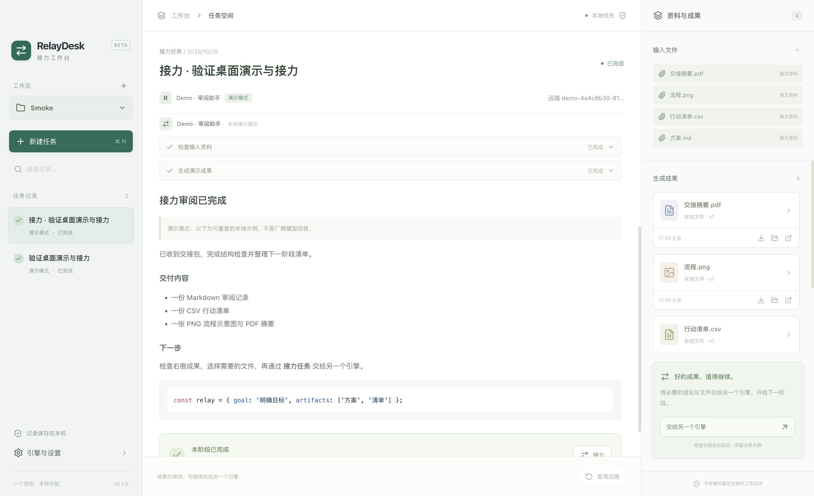
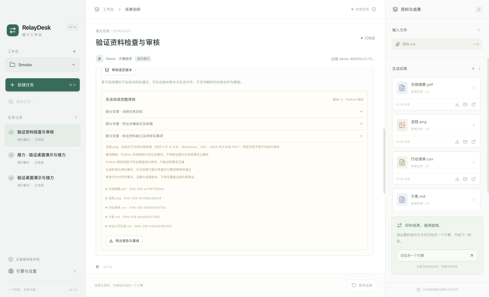

# RelayDesk · 接力工作台

RelayDesk 是一个统一管理 AI 任务、输入资料与生成成果的桌面应用。你可以直接让引擎执行任务，也可以先检查资料是否足够，再生成并审核成果，最后把选定成果交给另一个引擎继续处理。

支持独立演示模式、DeepSeek Harness（DSH）和 WorkBuddy。AI 检查能力使用 Python，任务、文件与本地存储使用 Node.js。

> DSH、WorkBuddy 已实现协议适配并通过本地协议测试，尚未完成真实账号端到端验证。Python 语义检查同样需要配置 DeepSeek API Key 后联调。演示模式与真实引擎独立，不代表厂商调用成功。

## 功能

- **工作区与任务**：选择本地目录，创建任务、添加资料，查看历史记录、流式回答、公开工具事件与执行状态。
- **资料准备检查**：编辑交付要求与关键词，定位资料证据，查看缺口和补充建议，确认生成范围后冻结基线。
- **成果审核**：根据生成前确认的基线检查选定成果，展示「所列检查通过」「需修改」或「无法完成完整审核」，支持导出报告和创建关联修改草稿。
- **成果管理**：预览、导出、用系统应用打开或打开所在目录；支持关联引擎生成的本地文件。
- **跨引擎接力**：编辑目标、已完成事项、关键结论、未解决问题与下一阶段要求，选择成果，创建关联任务。
- **本地保存**：重启后保留任务、事件、成果记录、基线、审核报告与接力关系。



## 安装与启动

需要：

- Node.js 24+ 与 npm。
- Python 3.9+，仅开启资料检查或审核时需要；无需安装第三方 Python 包。
- 已在 Apple Silicon macOS 验证桌面运行，其他平台尚未实测。

```sh
git clone https://github.com/px-l/RelayDesk.git
cd RelayDesk
npm ci
npm run dev
```

也可以构建后启动：

```sh
npm start
```

`npm run dev:web` 仅启动页面开发服务器，完整的本地功能需要在 Electron 桌面应用中使用。目前提供源码运行方式，尚未发布安装包。

## 无凭据体验

1. 点击左侧「工作区」的 `+`，选择一个本地目录。
2. 点击「新建任务」，选择 **Demo · 方案助手 · 演示模式**，输入需求并创建草稿。
3. 按需在右侧添加输入文件，点击「启动任务」。
4. 查看流式回答、工具记录和执行状态，在右侧预览或导出生成文件。
5. 点击「交给另一个引擎」，选择 **Demo · 审阅助手**，编辑交接内容并选择成果。
6. 确认后创建关联草稿，再点击「启动任务」。
7. 退出并重新打开应用，查看已保存的任务和接力关系。

Demo 使用可重复模板生成真实可打开的示例文件，不调用外部模型，也不声称理解输入文档。两种 Demo 角色用于展示不同处理阶段。

## 资料检查与成果审核

### 阶段选择

| 生成前检查资料 | 生成后自动审核 | 使用方式 |
|---|---|---|
| 关闭 | 关闭 | 直接生成，无需 Python |
| 开启 | 关闭 | 检查并确认基线后生成；完成后可手动审核 |
| 开启 | 开启 | 检查并确认基线后生成；完成后自动审核 |
| 关闭 | 开启 | 不支持，审核必须有生成前确认的基线 |

未做准备检查的任务，不能在生成完成后补建基线再审核。

### 操作步骤

1. 新建任务时开启「生成前检查资料」，按需开启「生成后自动审核」。这些选项可以在草稿阶段调整。
2. 在右侧添加资料，编辑交付要求和检索关键词，选择检查方式。
3. 点击「检查资料」，逐项查看证据、缺口、补充建议及解析限制。补充或移除资料后可重新检查。
4. 填写「生成范围与限制」，确认接受资料缺口，点击「确认并冻结基线」。资料发生变化后，需要重新检查。
5. 点击「启动任务」。引擎接收已确认的要求、限制和证据摘录；支持本地附件的引擎使用冻结副本。
6. 生成完成后自动审核，或手动选择成果及本轮公开回答进行审核。若成果未自动出现在右侧，可点击成果栏 `+` 关联本次生成的文件；远端文件须先下载。
7. 查看审核结果、问题与引用，按需导出包含基线的 JSON 报告。「需修改」时可以创建关联修改草稿，重新准备后再启动。

审核只针对所选成果版本。文件内容、版本或快照发生变化时，会提示旧审核不再适用；历史报告仍保留。「需修改」属于审核结果，不会把已经完成的生成任务改成执行失败。



### 两种检查方式

**Python 本地规则 · 无模型**

不联网，无需 API Key。按关键词定位资料片段，命中最多标记为「部分支撑」，不能判断资料是否充分或事实是否正确，也不会给出语义审核通过结论。

**Python Agent · DeepSeek 语义检查**

在「引擎与设置」中找到「Python 资料检查与审核 Agent」：

1. 按需填写 Python 可执行文件的绝对路径；留空使用 `python3`。
2. 保存 DeepSeek API Key 和模型名称，默认值为 `deepseek-flash`，实际可用性取决于账号。
3. 检查前明确同意发送目标及资料摘录；自动审核还需在基线确认时授权发送基线资料和成果。

检查 Agent 的 Key 与 DSH 自身凭据分开管理。凭据经系统密钥机制加密保存，不回传给页面。缺少 Key、网络失败或返回格式不完整时会明确报错，不自动降级为规则模式。

模型结果需要引用原文；审核通过判断同时要求成果引用和基线来源引用。模型评价仍不能代替事实核验。当前不支持自动联网补资料。

## 配置真实引擎

### DeepSeek Harness（DSH）

1. 按 [DSH 官方说明](https://github.com/deepseek-ai/deepseek-harness) 安装运行环境，并在 DSH 自身配置模型、凭据与工具权限。
2. 在 RelayDesk「引擎与设置」中填写已安装 `dsh` 可执行文件的**绝对路径**，保存后检测。
3. 新建任务时选择 DeepSeek Harness。

RelayDesk 通过 ACP 结构化通信获取公开回答、工具事件和审批请求，支持取消。检测通过只表示本地条件与握手可用，不代表模型调用成功。

本版不支持 DSH 成果自动发现和远端任务恢复。生成文件可在工作区查看，并通过成果栏 `+` 关联到已完成任务。DSH 工具的实际权限由其自身配置决定。

### WorkBuddy

1. 根据 [WorkBuddy Open API 文档](https://open.workbuddy.cn/docs/openapi) 注册应用，授权 `user.task.readable` 和 `user.task.invokable`。
2. 在自己的服务端完成 OAuth 授权，获得用户 access_token。
3. 在 RelayDesk「引擎与设置」中保存令牌并检测，然后选择 WorkBuddy 创建任务。

**OAuth clientSecret 必须保留在服务端，不能打包进桌面应用。** 可参考 [OAuth 服务端示例](examples/oauth-server/server.mjs) 和 [配置示例](examples/oauth-server/.env.example)。该示例用于自有应用联调，不提供完整登录与令牌刷新服务。

当前使用限制：

- 检测只验证任务读取权限，创建任务、ACP 和成果下载仍需账号实测。
- 未实现已验证的本地文件上传能力，不能直接把本地路径交给云端任务。开启准备检查时，本地资料供检查 Agent 使用，生成阶段仅发送基线要求和已确认的文字摘录。
- 接力到 WorkBuddy 时需取消文件选择，把必要结论写入交接包。
- 不支持取消任务或恢复历史流订阅。「查询远端」只查询已有任务状态，不重新执行原请求。
- 成果获取受官方返回接口与下载域限制；无法获取时请通过 WorkBuddy 导出，再关联本地文件。

## 文件预览与检查范围

| 文件类型 | 成果查看 | 内容检查与审核 |
|---|---|---|
| Markdown、UTF-8 文本、CSV、JSON | 内嵌预览，Markdown 支持代码高亮 | 支持文本提取 |
| PDF | 按页预览 | 支持文本型 PDF；扫描件不支持 |
| PNG、JPEG、GIF、WebP | 图片预览 | 不支持 |
| HTML | 隔离预览 | 不支持 |
| DOCX、XLSX、PPTX | 成果卡片、导出、系统应用打开 | 不支持 |

预览能力不等于内容审核能力。不支持解析或内容被截断时会明确列出限制，不能形成完整审核通过结论；演示成果也不会被当作真实成果审核通过。

- 输入与预览文件上限：20MB。
- 准备检查最多 6 个文件；审核最多 6 个成果，可另选本轮公开回答。
- 每份检查文本最多提取 18,000 字符，PDF 最多读取 60 页。
- CSV 预览最多展示前 500 行。

## 接力与数据保存

接力会携带必要资料**创建新任务**，保留前后任务关联，不迁移厂商内部会话状态。交接包默认使用明确摘要与所选成果，不发送完整聊天历史，也不额外调用模型生成摘要。确认交接后先创建草稿，由用户启动。

任务数据库和加密设置保存在 Electron 的用户数据目录，macOS 通常为：

```text
~/Library/Application Support/relaydesk/
```

输入副本、成果和检查快照保存在所选工作区的 `.relaydesk/<task-id>/` 中。备份时需同时保留用户数据目录和工作区；移动或删除工作区文件会影响预览与审核有效性。

应用重启后，尚未完成的执行或检查会显示中断，不会自动重新派发或调用模型。真实任务中断后应先核对远端状态，避免重复执行。

## 开发检查

```sh
npm run check   # 类型检查、Node 测试、Python 测试、生产构建
npm run smoke   # 真实 Electron 窗口中的演示与检查流程验证
```

已有验证记录包含 33 项 Node 测试、10 项 Python 测试及 macOS 桌面流程测试。`smoke` 使用独立临时数据库与工作区，不使用个人账号，不修改正常应用数据。

更多信息：[验证记录](docs/validation.md) · [架构说明](architecture.md) · [Python 检查模块](agent_runtime/README.md) · [引擎协议核查记录](docs/integration-notes.md)

## 当前范围

每个任务执行一轮请求，后续处理通过接力或修改草稿进行。暂不提供多轮追问、自动多 Agent 编排、工作流画布、向量知识库、多租户、计费、安装包签名或自动更新。

## 许可证

[MIT](LICENSE)
