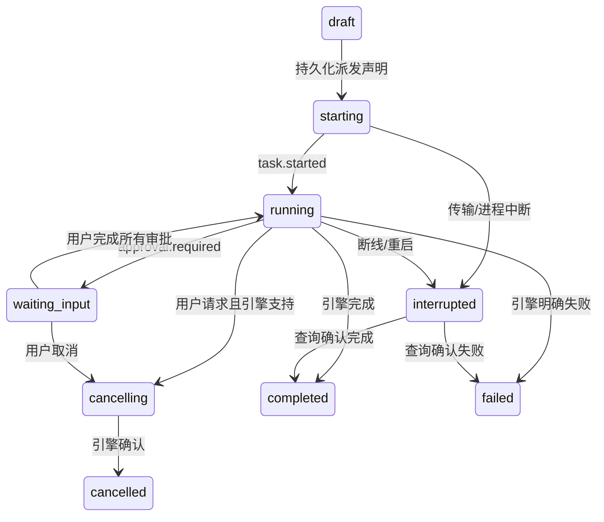

# RelayDesk 架构速览

## 1. 分层与边界

渲染层只认识 `shared/types.ts` 的任务、成果、能力与统一事件，不依赖厂商 RPC。preload 暴露 request/subscribe 两个窄接口。主进程承担 Node 本地后端，不额外开放 HTTP 端口。

`TaskService` 管执行生命周期与接力；`EngineAdapter` 隔离传输；`Store` 管 SQLite；`files.ts` 管授权目录。厂商 SDK 更新只影响适配器及契约测试。数据规模扩大后，可将后端迁到 Electron utilityProcess / worker，不改变前端接口。

## 2. 适配器

统一接口包含 info/capabilities、check、createTask、sendMessage、subscribe、getStatus、getArtifacts；cancel/recover/approve/downloadArtifact 为可选。sendMessage 发送连接内的初始请求；任务结束后不保留活动连接，未实现的追问直接报不支持。运行上下文注入 emit 和 bindRemote，使适配器不依赖 SQLite 或 Electron UI。

- Demo：本地可重复执行，使用真正的工作区文件；独立标记、独立远端标识，不回退冒充真实引擎。
- DSH：无 shell 子进程 + ACP JSON-RPC stdio；初始化、建会话、prompt、公开工具事件与权限响应。stderr 排空但不采集展示文本。DSH 公布的 thought 内容不映射。
- WorkBuddy：固定 REST 主机建任务，拿到 ID 立即持久化，再使用返回通道的 SSE 与 JSON-RPC。审批与真实结构化成果映射。未开放上传/取消则禁用。

检测结果严格分为未配置、待验证、可用、检测失败；「可用」的描述精确限定检测内容，握手/任务列表成功不代表模型或下载成功。

## 3. 事件与状态机

事件含 taskId、eventId、时间、单调本地 sequence、可选 sourceCursor 和判别式 payload。基础事件覆盖 started、delta、tool、artifact、approval 和三种终态。

SQLite `(task_id,event_id)` 唯一约束在事务中去重，再同时更新任务投影和成果表。事件 sequence 由后端在任务内分配，远端游标单独保存。SSE 提供 id 时复用为 eventId；没有游标时本地 UUID 仅保证应用投递去重，不声称能区分厂商无 ID 的重复内容，因此不做可能重复的自动流重连。

终态不被迟到事件回退。连接中断写入本地状态，不伪造厂商 task.failed。持久化 dispatched 在外部副作用之前完成；进程崩溃、HTTP 超时或用户重复点击都不能重复建任务。极端情况下创建已被远端接受但尚未返回 ID，记录保持中断，要求人工在厂商核对；没有厂商幂等键就不虚构 exactly-once 保证。

前端按 taskId/字段细粒度订阅；文本事件每 60ms 批处理，对话更新不会重新渲染任务列表和成果栏。工具/终态触发本地投影刷新。历史事件从 SQLite 读取，与远端恢复分开。

## 4. 恢复策略

启动时把非草稿、非终态的任务标记中断并保留远端 ID。WorkBuddy 显式恢复只查询同一远端任务，不重发 prompt。协议没有历史游标保障时，不拼接重放文本。DSH 本版无可靠未完成请求查询，故禁用恢复。适配器新增恢复需要证明订阅恢复与副作用幂等，而不仅是重放本地事件。

## 5. 成果与接力

成果拥有稳定 ID、来源任务/引擎、MIME、版本、时间；位置是 local path 或 remote fileId + 可选下载链接的判别联合。远端 URI 不当成本地路径。下载保留 sourceRemoteFileId，工作区内独占落盘。官方成果更新按 URI upsert，删除通知移除卡片。

交接草稿只使用原始目标、明确完成摘要及成果，不默认发送整段历史，不额外调用模型。用户编辑五部分内容，选择原任务成果；后端验证归属、文件边界和目标引擎上传能力，然后建立带 parentId 的新草稿。再次显式启动后携带必要资料执行。此机制不迁移厂商内部会话状态。

## 6. 安全与验证重点

严格 Zod IPC + 主 frame 校验、contextIsolation、禁 Node 集成、默认权限拒绝、禁止导航；HTML iframe 不具备 preload；PDF.js 只绘制页面，不执行文档动作。路径用 realpath 和相对关系判断，防相邻同名前缀与软链接越界，输出独占创建。DSH 自己的工具权限归其安全策略，应用不声称提供 OS 沙箱。

凭据经系统密钥加密后保存，渲染层仅见是否存在；OAuth clientSecret 在独立服务端。远程鉴权主机受限，下载不跟随重定向，不把 ACP token 传给第三方 URL。

测试集中于去重、终态、并发派发声明、交接归属、目录边界、取消与重启数据；两组协议替身验证官方方法顺序、响应关联、公开增量过滤及远端恢复不重发。Electron smoke 验证真正窗口、桥接、SQLite、预览和接力编辑界面。真实账号联调是独立验收项。
